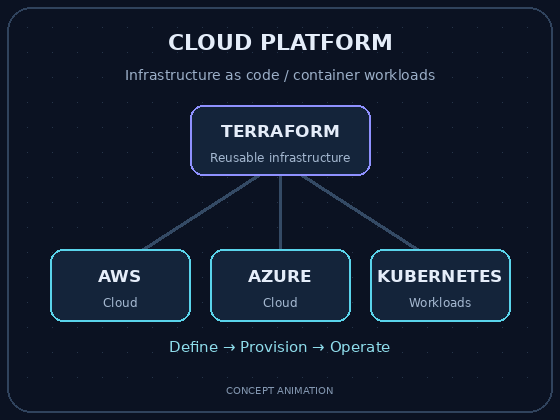
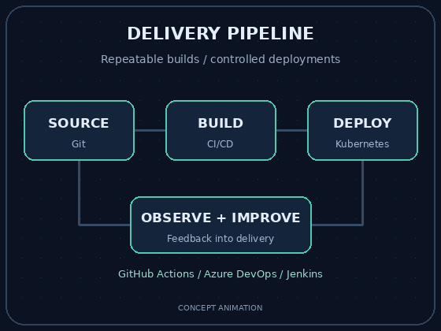
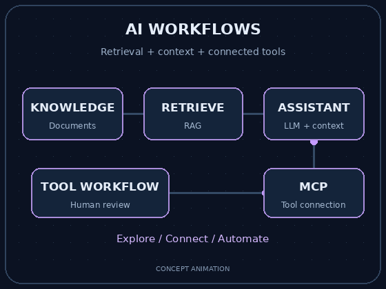

<h1 align="center">Hi, I'm Prasanjit Sahoo 👋</h1>

<h3 align="center">
  Senior DevOps Engineer
</h3>

  <strong>☁️ Cloud & Platform Engineering · ⚙️ DevOps Automation · 🤖 AI Automation</strong>

  
  
  

---

## 👨‍💻 About me

I work on CI/CD pipelines, Kubernetes platforms, cloud infrastructure,
and automation. My focus is making infrastructure easier to manage
and software delivery more consistent.

I'm also exploring how AI-powered developer tools, Model Context
Protocol (MCP) integrations, and agent workflows can support everyday
engineering work.

## 🛠️ Tools & technologies

<table>
<tr>
<td width="60%" valign="middle">

<h3>☁️ Cloud & Infrastructure</h3>

  

AWS · Microsoft Azure · Terraform · Reusable infrastructure modules

</td>
<td width="40%" align="center" valign="middle">

</td>
</tr>
</table>

<table>
<tr>
<td width="60%" valign="top">

<h3>⚙️ CI/CD & Version Control</h3>

  

GitHub Actions · Azure DevOps · Jenkins · Git

<h3>📦 Containers & Delivery</h3>

  

Docker · Kubernetes · GitOps · Deployment automation

</td>
<td width="40%" align="center" valign="middle">

</td>
</tr>
</table>

### 🐧 Scripting & Observability

  

Python · Bash · Linux · Grafana · Application and infrastructure monitoring

### 💻 Programming Languages & Frameworks

  

Python · Java · .NET

<table>
<tr>
<td width="60%" valign="top">

<h3>🧠 AI Assistants</h3>

  
  &nbsp;&nbsp;
  
  &nbsp;&nbsp;
  

ChatGPT · Claude · Gemini

<h3>🧑‍💻 AI Coding Tools</h3>

  
  &nbsp;&nbsp;
  

GitHub Copilot · Cursor

</td>
<td width="40%" align="center" valign="middle">

</td>
</tr>
</table>

### 🤖 AI Automation

| 🤖 AI-Powered Developer Tools | 🔌 MCP Integrations | 📚 RAG | ⚙️ Agent Workflows |
| :---: | :---: | :---: | :---: |
| Tools for engineering tasks | Connecting AI to tools and data | Retrieval-Augmented Generation | Automating multi-step tasks |

## 🔭 Current focus

- Automating build and deployment pipelines.
- Managing Kubernetes platforms and cloud infrastructure.
- Exploring AI-assisted DevOps workflows and advanced MCP integrations.

## 🤝 Open to collaboration

I'm interested in working with others on:

- DevOps tools and CI/CD automation.
- Kubernetes deployment workflows.
- Reusable Terraform modules.
- AI-powered developer tools.

## 💬 Let's connect

Happy to discuss DevOps, cloud infrastructure, Kubernetes, Terraform,
GitOps, and AI automation.

- **LinkedIn:** [Prasanjit Sahoo](https://www.linkedin.com/in/iamprasanjitsahoo)
- **Email:** [prasanjit.sahoo521@gmail.com](mailto:prasanjit.sahoo521@gmail.com)

---

  Thanks for visiting 👋

